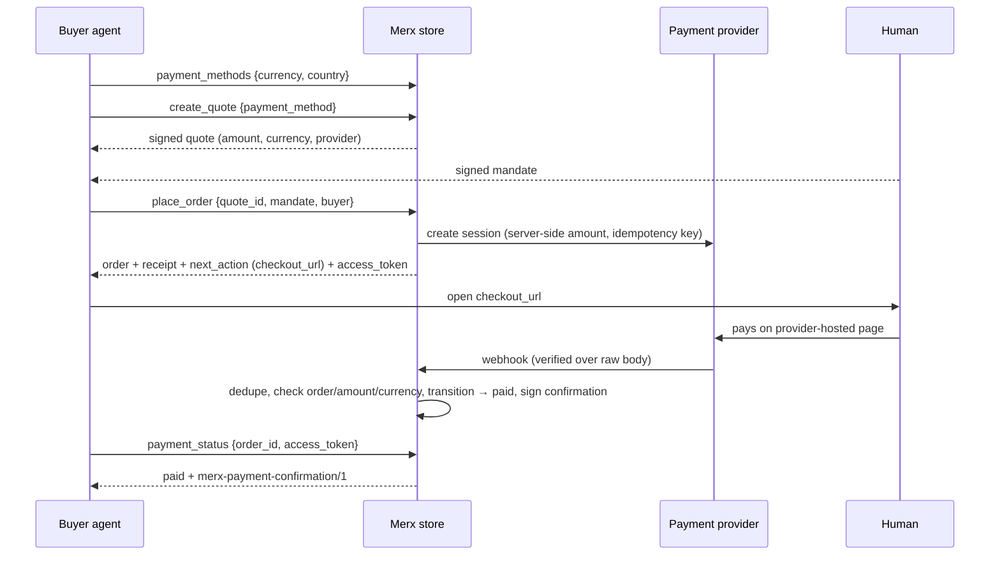

# Payments in Merx

Merx separates three things that are easy to blur in agentic commerce:

1. **Authorization** — the human's signed spending mandate (`merx-mandate/1`).
2. **Order acceptance** — the store-signed receipt (`merx-receipt/1`). It means *accepted*, not *paid*.
3. **Settlement** — a payment verified with the provider, recorded on `order.payment.status` and proven by a store-signed **payment confirmation** (`merx-payment-confirmation/1`).

The design, state machine and threat model are in [ADR 0001](adr/0001-verified-payments.md).

## Status

| Capability | Status |
|---|---|
| Multiple providers, discovery by currency/country, quote-bound selection | Implemented (0.2) |
| Payment state machine separate from fulfillment | Implemented (0.3) |
| Durable orders, nonces, deals, stock, attempts, webhook events (`SqliteStore`) | Implemented (0.3), single node |
| Stripe Checkout adapter (test mode by default) | Implemented (0.3), optional |
| GoPay adapter (sandbox by default) | Implemented (0.3), optional |
| Signed payment confirmation, access-controlled `payment_status` | Implemented (0.3) |
| Reconciliation, refunds, cancellation (server-side/admin) | Implemented (0.3) |
| PostgreSQL store for multi-instance deployments | Planned |
| Dispute workflow, partial captures | Planned |
| x402, AP2, UCP/ACP payment mappings | Planned, separate adapters |
| Fictional bank transfer demo | Bundled; **never settles** |

Merx is not affiliated with Stripe or GoPay, and their adapters are not endorsements. Availability of each provider depends on your country, business and contract.

## Choosing a provider

| Provider | Flow | Verifies settlement | Webhook authentication | Refunds |
|---|---|---|---|---|
| `bank_transfer` (demo) | manual instructions | No | — | — |
| `stripe_checkout` | hosted page redirect | Yes | `Stripe-Signature` HMAC over raw body | Yes |
| `gopay` | hosted gateway redirect | Yes | Server-to-server status lookup (notifications are unsigned) | Yes |
| Your adapter | any | If you implement `verifyWebhook`/`getPaymentStatus` | your scheme | optional |

All adapters use Node's built-in `fetch` and `crypto`. **Merx still has zero runtime dependencies.**

## The agent flow



Agents must treat the return/success URL as navigation only. **A redirect is never proof of payment**; poll `payment_status`.

### Agent operations

Available identically over REST, MCP and A2A (defined once in `src/adapters/operations.ts`):

| Operation | REST | Access |
|---|---|---|
| `payment_methods` | `GET/POST /v1/payment-methods` | public |
| `place_order` | `POST /v1/orders` | mandate; returns `access_token` once |
| `get_order` | `GET /v1/orders/:id` | `Merx-Order-Token` header (required if `MERX_REQUIRE_ORDER_TOKEN=1`) |
| `payment_status` | `GET /v1/orders/:id/payment` | `Merx-Order-Token` header, always |
| `payment_confirmation` | `GET /v1/orders/:id/payment/confirmation` | `Merx-Order-Token` header, always |

`payment_status` returns the payment state, whether the provider verifies settlement, refunded amount, and a `next_action`: `redirect`, `follow_instructions` (unverified demo), `wait`, `contact_merchant` or `none`. It never contains buyer PII or provider secrets.

### Verifying a payment confirmation

```ts
import { publicKeyFromB64, verifyObject } from "../src/core/crypto.ts";

const manifest = await (await fetch(`${store}/.well-known/merx.json`)).json();
const conf = await (await fetch(`${store}/v1/orders/${orderId}/payment/confirmation`, { headers: { "merx-order-token": accessToken } })).json();
const ok = verifyObject(conf.payload, conf.signature.value, publicKeyFromB64(manifest.public_key.spki_der_b64));
// Also check conf.payload.order_id, amount and quote_hash against your own records.
```

## Running with Stripe (test mode)

1. Create a Stripe account and copy a **test** secret or restricted key (`sk_test_…`/`rk_test_…`).
2. Add a webhook endpoint for `https://<your-store>/v1/webhooks/payments/stripe_checkout` with the events `checkout.session.completed`, `checkout.session.async_payment_succeeded`, `checkout.session.async_payment_failed` and `checkout.session.expired`. Copy its signing secret (`whsec_…`). For local work, the Stripe CLI can forward events.
3. Start Merx:

```bash
MERX_PUBLIC_URL=https://your-store.example \
STRIPE_SECRET_KEY=sk_test_... \
STRIPE_WEBHOOK_SECRET=whsec_... \
MERX_STORE=sqlite:.merx/merx.db \
MERX_ADMIN_TOKEN=$(openssl rand -hex 32) \
npm start
```

Live keys are refused unless `STRIPE_ALLOW_LIVE=1` (or `allowLiveMode: true`). Do that only after the [production checklist](#production-checklist).

Programmatic use:

```ts
import { createMerx } from "../src/server.ts";
import { stripeCheckout } from "../src/payments/stripe.ts";
import { SqliteStore } from "../src/storage/sqlite.ts";

const { server, engine } = createMerx({
  catalog,
  privateKeyPem,
  store: new SqliteStore(".merx/merx.db"),
  payments: [stripeCheckout({
    secretKey: process.env.STRIPE_SECRET_KEY!,
    webhookSecret: process.env.STRIPE_WEBHOOK_SECRET,
    successUrl: "https://shop.example/payment/return?session_id={CHECKOUT_SESSION_ID}",
    cancelUrl: "https://shop.example/payment/cancelled",
    currencies: ["EUR"],
  })],
  adminToken: process.env.MERX_ADMIN_TOKEN,
});
await engine.ready();
```

What the adapter does: creates a Checkout Session from the order total (one line item, `client_reference_id` and metadata carry the order ID and quote hash), sends `Idempotency-Key: merx:<attempt key>`, returns only the hosted URL, verifies `Stripe-Signature` over the raw body (5-minute tolerance), checks `livemode` and optional Connect `account`, and refunds against the session's PaymentIntent with an idempotency key.

## Running with GoPay (sandbox)

```bash
MERX_PUBLIC_URL=https://your-store.example \
GOPAY_CLIENT_ID=... GOPAY_CLIENT_SECRET=... GOPAY_GOID=... \
GOPAY_ENVIRONMENT=sandbox \
npm start
```

The notification URL defaults to `<MERX_PUBLIC_URL>/v1/webhooks/payments/gopay`. GoPay sends an HTTP GET with only the payment `id` and no signature, so the adapter **never trusts the notification**: it calls `GET /api/payments/payment/{id}` with OAuth credentials and the engine verifies that state (amount, currency, order number) before any change. Dedupe uses `<id>:<state>`. GoPay's API has no idempotency keys; see ADR 0001 for how orphan payments are handled.

Production requires `GOPAY_ENVIRONMENT=production` (`https://gate.gopay.cz`). Check [GoPay's current documentation](https://doc.gopay.com/) for your contract's payment instruments.

## Environment variables

| Variable | Purpose |
|---|---|
| `MERX_STORE` | `memory` (default) or `sqlite:<path>` |
| `MERX_PUBLIC_URL` | Base URL used to derive return and notification URLs |
| `MERX_ADMIN_TOKEN` | Enables `/admin/v1/*` with `Authorization: Bearer` (≥ 32 chars) |
| `MERX_REQUIRE_ORDER_TOKEN` | `1` to require the access token for `get_order` |
| `MERX_DEFAULT_PAYMENT_METHOD` | Provider ID used when a quote does not name one |
| `MERX_DISABLE_DEMO_TRANSFER` | `1` to hide the fictional bank transfer |
| `MERX_RECONCILE_INTERVAL_SECONDS` | Periodic reconciliation of open payments (min 60) |
| `STRIPE_SECRET_KEY`, `STRIPE_WEBHOOK_SECRET` | Enable Stripe Checkout |
| `STRIPE_SUCCESS_URL`, `STRIPE_CANCEL_URL` | Override derived URLs |
| `STRIPE_CURRENCIES`, `STRIPE_COUNTRIES` | Comma-separated allowlists (default `EUR`, all destinations) |
| `STRIPE_ACCOUNT_ID`, `STRIPE_API_VERSION`, `STRIPE_ALLOW_LIVE` | Connect account, pinned API version, live opt-in |
| `GOPAY_CLIENT_ID`, `GOPAY_CLIENT_SECRET`, `GOPAY_GOID` | Enable GoPay |
| `GOPAY_ENVIRONMENT`, `GOPAY_RETURN_URL`, `GOPAY_NOTIFICATION_URL`, `GOPAY_LANG`, `GOPAY_CURRENCIES`, `GOPAY_COUNTRIES` | GoPay options |

See [`.env.example`](../.env.example). Never commit real values.

## Administrative operations

Enabled only with `MERX_ADMIN_TOKEN`; all are audited.

| Endpoint | Engine method | Notes |
|---|---|---|
| `GET /admin/v1/orders/:id` | `getOrder` | full order incl. buyer data |
| `POST /admin/v1/orders/:id/reconcile` | `reconcilePayment` | pulls provider status (missed/late webhooks) |
| `POST /admin/v1/payments/reconcile` | `reconcileOpenPayments` | all open verified payments |
| `POST /admin/v1/orders/:id/retry-payment` | `retryPayment` | same key after a setup failure; new attempt after failure/cancellation |
| `POST /admin/v1/orders/:id/refund` | `refundPayment` | `{ amount?, reason?, idempotency_key }`; bounded by the refundable amount |
| `POST /admin/v1/orders/:id/cancel` | `cancelOrder` | unpaid orders only; expires the provider session when supported; returns stock |

Engine events for your own integrations: `order.created`, `payment.updated`, `order.paid`, `order.cancelled`, and **`payment.anomaly`** (amount mismatch, duplicate settlement, payment after cancellation) — route the last one to a human.

## Writing a payment adapter

Only `createPayment` is required; anything returned is shown to the agent as unverified instructions. To make settlement verifiable, implement the optional capabilities:

```ts
import type { PaymentProvider } from "../src/core/payments.ts";
import { WebhookVerificationError } from "../src/core/payments.ts";

export function myGateway(cfg: { apiKey: string; webhookSecret: string }): PaymentProvider {
  const provider: PaymentProvider = {
    id: "my_gateway",
    descriptor: { label: "My gateway", flow: "redirect", protocols: ["my-gateway/1"], currencies: ["EUR"], verifies_settlement: true },
    async initiatePayment(req) {
      // Use req.total / req.currency (server-validated) and req.idempotency_key.
      const s = await createSessionWithGateway(req);
      return { status: "requires_action", provider_payment_id: s.id, instructions: { type: "redirect", checkout_url: s.url } };
    },
    async createPayment(req) { return (await provider.initiatePayment!(req)).instructions; },
    async getPaymentStatus(id) { return mapStatus(await fetchStatus(id)); }, // { status, amount, currency, order_id }
    async verifyWebhook({ rawBody, headers }) {
      if (!validSignature(rawBody, headers, cfg.webhookSecret)) throw new WebhookVerificationError("bad signature");
      const e = JSON.parse(rawBody.toString());
      return { event_id: e.id, provider_payment_id: e.payment_id, ...mapStatus(e) };
    },
  };
  return provider;
}
```

Rules the engine enforces for every adapter, so you do not have to: event dedupe, order linkage, amount/currency match before any settled state, allowed transitions only, signed confirmation, audit trail. Rules **you** must follow: verify authenticity before returning an event, honor the idempotency key, never return secrets or card data in `instructions`, and map unknown provider states to an error rather than guessing. Add mocked tests; CI must never need live credentials. See [`examples/payments/`](../examples/payments/) and [ADAPTERS.md](ADAPTERS.md).

## Failure handling

| Situation | Behavior |
|---|---|
| Provider timeout during setup | Order kept, `payment_setup_failed`; retry reuses the same idempotency key |
| Session expired / payment failed | Attempt closed; retry opens attempt *n* with key `<order_id>:<n>` |
| Webhook lost | `reconcilePayment` / periodic reconciliation |
| Webhook duplicated or out of order | Deduplicated by event ID; backwards transitions ignored |
| Webhook for an unknown session | Acknowledged and ignored (or adopted if it is a verified, settled payment for a known order) |
| Amount/currency mismatch | Rejected (HTTP 400), audited, `payment.anomaly` |
| Old session paid after a new one | Recorded; duplicate settlement raises `payment.anomaly` |
| Payment after cancellation | Recorded as paid; `payment.anomaly` so the merchant refunds |

Exactly-once charging is not promised: Merx combines at-least-once delivery, idempotent processing and provider-side idempotency.

## Production checklist

- [ ] Durable store configured (`SqliteStore` for one node; a PostgreSQL adapter for several instances).
- [ ] HTTPS everywhere; the webhook endpoint reachable by the provider; request size and rate limits at the edge.
- [ ] Secrets from environment or a secret manager; restricted provider keys; logs scrubbed.
- [ ] Webhook signing secret configured; reconciliation scheduled.
- [ ] `MERX_ADMIN_TOKEN` set, stored like a password, and admin routes not exposed publicly if possible.
- [ ] `MERX_REQUIRE_ORDER_TOKEN=1`.
- [ ] Mandate principal keys accepted only from trusted wallets.
- [ ] `payment.anomaly` routed to a human.
- [ ] Your own review of the provider's current documentation, your contract, tax and consumer-protection obligations.

Using provider-hosted pages keeps card data out of Merx, but **Merx makes no PCI DSS or regulatory compliance claim**. Security readiness depends on your deployment, key management, review and verified provider events.

## Reference specifications

- [Stripe Checkout](https://docs.stripe.com/payments/checkout) and [webhook signatures](https://docs.stripe.com/webhooks#verify-events)
- [GoPay REST API](https://doc.gopay.com/)
- [AP2](https://ap2-protocol.org/), [x402](https://www.x402.org/), [UCP](https://ucp.dev/), [ACP](https://www.agenticcommerce.dev/) — not implemented; see the roadmap. The Merx mandate is **not** AP2.
