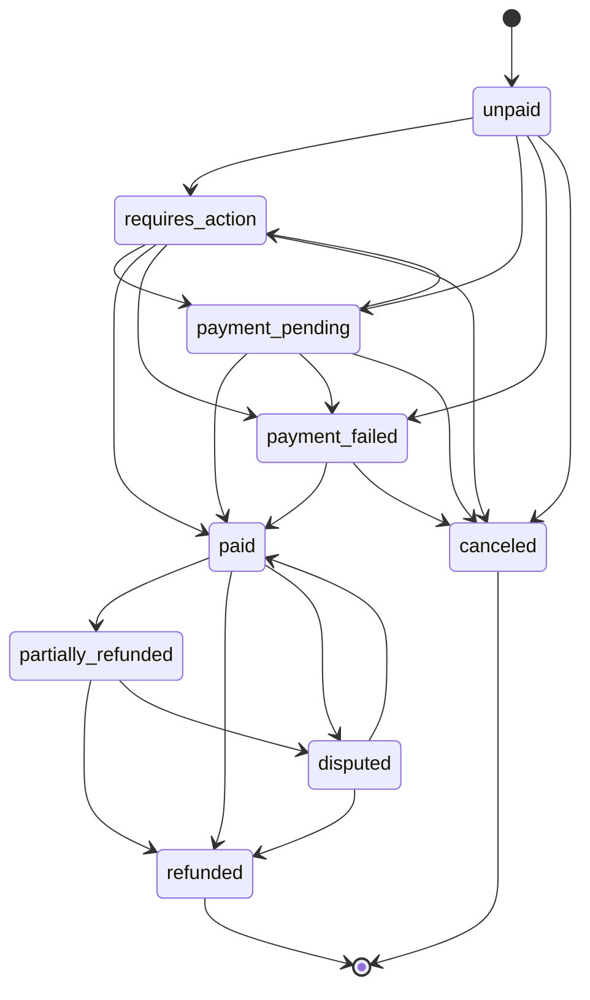

# ADR 0001 — Verified payments, durable state and the payment state machine

- **Status:** Accepted (implemented in 0.3.0)
- **Date:** 2026-11-21
- **Scope:** `src/core/{engine,payments,payment-state,storage,money}.ts`, `src/storage/sqlite.ts`, `src/payments/*`

## Context

Up to 0.2.0 Merx accepted orders against a signed quote and a signed spending mandate, then asked a `PaymentProvider` for buyer-facing instructions. Nothing ever verified that money arrived. All state lived in process memory: a restart forgot orders, consumed mandate nonces and redeemed deal tokens, which made a replayed mandate valid again.

The goal of this change is real, verifiable payment processing that stays open source, provider-neutral, self-hostable and testable offline.

## Decisions

### 1. Two state machines, one receipt meaning

The **order receipt** (`merx-receipt/1`) keeps its 0.2 meaning: *the merchant accepted this order*. It is not proof of payment and its format did not change.

Payment has its own state machine on `order.payment.status`:

The allowed transitions are a table in `payment-state.ts`. Any event that would move backwards (a late `payment_pending` after `paid`) is ignored and audited, never applied. A canceled attempt is closed; a retry opens a new attempt that starts again at `unpaid`.

A separate signed **payment confirmation** (`merx-payment-confirmation/1`) is issued once, when a provider event or reconciliation verified settlement. It binds the order ID, quote hash, receipt hash, amount, provider and provider payment ID.

Fulfillment (`shipped`, `delivered`) stays on the legacy `order.status` field, which is now *derived* from payment state for compatibility (`awaiting_payment`, `paid`, `refunded`, `payment_setup_failed`, `cancelled`).

### 2. Payment attempts

An order has one or more attempts. Attempt 1 keeps the 0.2 idempotency key (the order ID), so existing providers keep their retry semantics. A provider-confirmed failure or cancellation lets a trusted backend open attempt *n* with key `<order_id>:<n>`. Setup exceptions (timeouts) reuse the current attempt and key, because the provider may already have created the session.

If an older attempt settles after a newer one was opened, Merx records it: it becomes the order's payment if nothing else settled, otherwise a `payment.anomaly` (`duplicate_settlement`) is raised for a refund. A verified, settled provider payment with no recorded attempt (a request that timed out after creation) is adopted after the same checks.

### 3. Provider capabilities instead of a fatter interface

`PaymentProvider.createPayment` remains the only required method. Verified providers add optional capabilities:

| Capability | Method | Used for |
|---|---|---|
| Verified setup | `initiatePayment` | returns `provider_payment_id` and status |
| Status | `getPaymentStatus` | reconciliation, callback-only providers |
| Webhook | `verifyWebhook` | authenticates notifications (raw body) |
| Refund | `refund` | administrative refunds |
| Cancel | `cancelPayment` | expire an open session on order cancellation |

The engine — not the adapter — deduplicates events, checks order linkage, amount and currency, applies transitions and signs confirmations, so these rules are identical for every provider.

### 4. Durable state behind `MerxStore`

`MerxStore` persists orders (with the SHA-256 of the buyer's access token), consumed nonces, redeemed deals, cumulative stock deductions, payment attempts, processed webhook event IDs and an audit trail. `commitOrder` is atomic and must reject duplicate order IDs, nonces and deals; `saveAttempt` must reject duplicate idempotency keys and provider references.

Bundled implementations:

- `MemoryStore` — default, non-durable, for tests and demos.
- `SqliteStore` — built-in `node:sqlite` (Node ≥ 22.13), WAL, `BEGIN IMMEDIATE`, versioned migrations. Single node.

A PostgreSQL adapter for multi-instance deployments is the next storage milestone. Store methods may return promises so a network database fits the same interface. Quotes, stock holds and negotiation sessions stay in memory: losing them on restart only releases holds early, which is safe.

### 5. Buyer access tokens

`place_order` returns a random 256-bit `access_token` exactly once; only its hash is stored. `payment_status` and `payment_confirmation` always require it. `get_order` verifies it when given and requires it when `requireOrderAccessToken` is set (planned default in 0.4). `Merx-Agent-Id` remains identification, not authentication.

### 6. Administrative surface

Reconcile, retry, refund and cancel are engine methods. The reference server exposes them under `/admin/v1/*` only when `MERX_ADMIN_TOKEN` (≥ 32 characters) is set, compared in constant time. They are never agent operations.

## Trust boundaries and threat model

| Boundary | Trusted for | Not trusted for | Controls |
|---|---|---|---|
| Buyer agent | nothing beyond its signed mandate | amounts, currency, provider choice outside the quote, payment proofs | signed quote, mandate verification, server-side totals, access token |
| Human / wallet | spending authorization (mandate key) | identity binding (not yet) | Ed25519 mandate, one-time nonce persisted |
| Merchant server | business logic, secrets | — | env/secret manager, no secrets in responses or logs |
| Payment provider API | authoritative payment state | — | HTTPS, server-side credentials, response validation |
| Webhook endpoint | nothing until verified | body, headers, query | signature over raw body (Stripe) or server-to-server lookup (GoPay), replay table, amount/order checks |
| Browser redirect / return URL | nothing | payment success | never changes state |

Threats addressed and how:

- **Forged or replayed webhooks** — HMAC over the raw body with timestamp tolerance; event IDs stored; idempotent transitions.
- **Amount tampering** — totals come only from the signed quote; settled events must match amount and currency.
- **Cross-order confusion** — provider metadata order ID must match the attempt's order.
- **Duplicate charges** — provider idempotency keys; per-order serialization; atomic order commit; attempt uniqueness.
- **Mandate replay across restarts** — nonces persisted with a unique constraint.
- **Order enumeration** — payment endpoints require the access token; tokens travel in a header, not in URLs.
- **SSRF / redirect injection** — provider base URLs and callback URLs come from configuration only; checkout URLs must be HTTPS.
- **Information leaks** — provider error bodies are never surfaced; payment status contains no buyer PII.

Out of scope for this change: PCI scope reduction beyond using hosted pages, dispute handling automation, chargeback evidence, rate limiting (deployment concern), wallet identity binding, AP2/x402.

## Current vs proposed API map

| Area | 0.2.0 | 0.3.0 |
|---|---|---|
| Provider contract | `createPayment` | + optional `initiatePayment`, `getPaymentStatus`, `verifyWebhook`, `refund`, `cancelPayment` |
| Payment state | `order.status` only | `order.payment.status` + derived legacy `order.status` |
| Proof of payment | none | `payment.confirmation` (`merx-payment-confirmation/1`) |
| Persistence | in-memory maps | `MerxStore` (`MemoryStore`, `SqliteStore`) |
| Buyer reads | `get_order` by ID | + `payment_status`, `payment_confirmation` with access token |
| Recovery | `retryPayment` | + `reconcilePayment`, `reconcileOpenPayments`, `refundPayment`, `cancelOrder` |
| Webhooks | none | `/v1/webhooks/payments/:provider` (raw body) |

## Consequences

- Existing integrations keep working without code changes; responses gain fields.
- Providers that only implement `createPayment` are shown as `verifies_settlement: false`, and agents are told so in `next_action`.
- Exactly-once charging is not promised. Merx aims for at-least-once delivery with idempotent processing plus provider-side idempotency.
